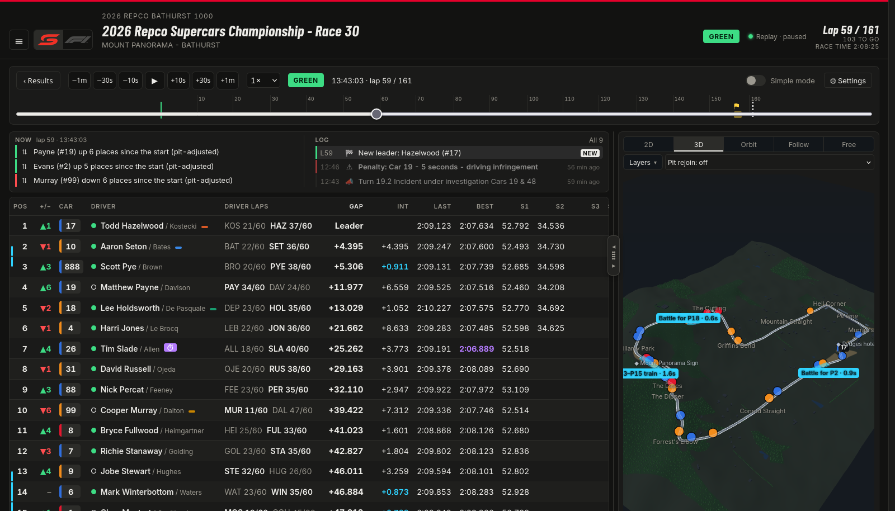
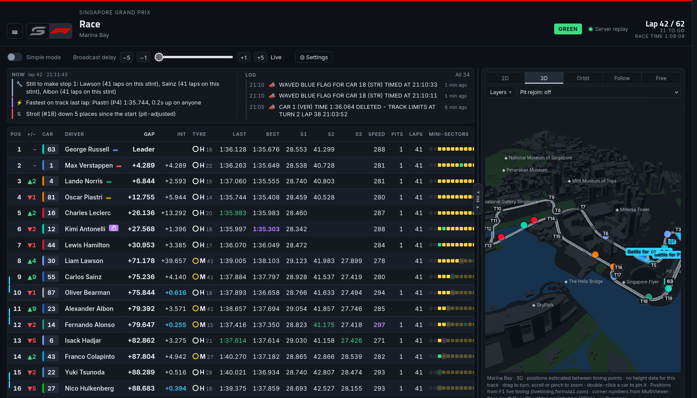
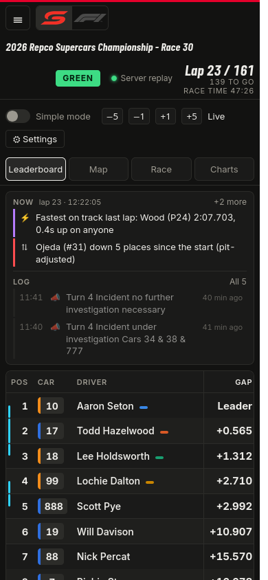
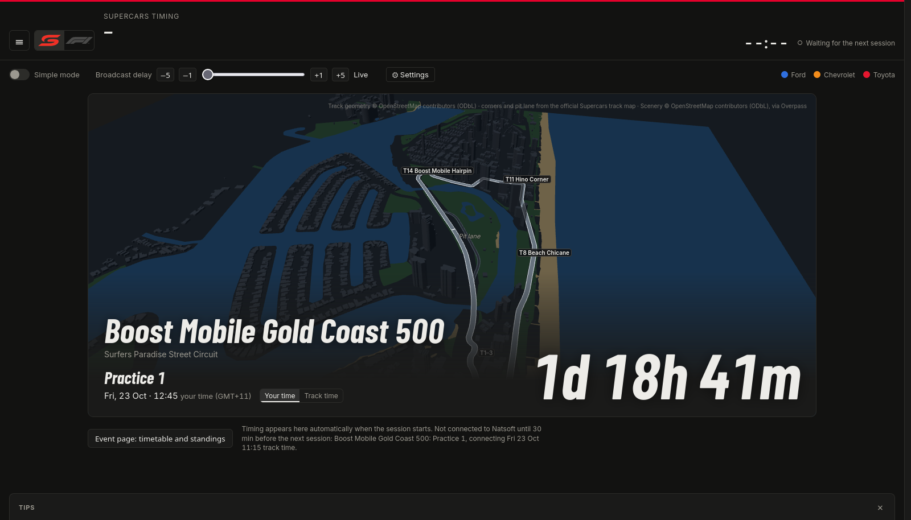

# Supercars Timing

A live timing dashboard for the Repco Supercars Championship, built because the free timing on supercars.com is a
plain table and the F1 fan dashboards are so much better. It reads the same Natsoft feed that powers the official
"classic" timing and turns it into a timing tower, a 3D track map with every car on it, a race feed, charts and
full replays of every session it has recorded.

There's an F1 version too, at `/f1`, on F1's public live timing. Same server, same frontend.

It's a personal project: it runs as a service on a small home server and I watch it on my tailnet over race weekends. It
followed the 2026 Bathurst 1000 from the first lap to the flag, safety car and penalties included.



<table>
  <tr>
    <td width="68%"></td>
    <td width="32%"></td>
  </tr>
  <tr>
    <td>The F1 app during the Singapore Grand Prix</td>
    <td>On a phone</td>
  </tr>
</table>



## What it does

**The tower.** Gaps and intervals worked out at every timing point rather than once a lap, mini-sectors, driver
and co-driver laps against the minimum, pit timers, penalty badges, positions gained, and rows that slide when
someone passes. Battles get a bracket down the side; undercuts get a tag saying who's ahead if they pit now. A simple
mode cuts it down to the basics.

**The map.** Natsoft only says when a car crosses one of a handful of timing points per lap, so the map fills in
the gaps: each car moves at its own recent pace, slows for corners, and gets paced differently under a safety car.
It's 2D or 3D, with buildings, trees and landmarks from OpenStreetMap, and Mount Panorama sits on its real hillside.
You can orbit, follow a car, or fly around freely.

**The race feed.** A short list of what matters right now (battles, who's closing, strategy, minimum-lap risk) and a
log of lead changes, fastest laps, race control messages and safety cars.

**Broadcast delay.** Slide the timing back until it lines up with your TV or stream. The map uses what it already
knows about the next timing point, so it stays smooth even with a 30 second delay.

**Replays and results.** Every session is recorded. Pick one from the menu for the classification, a race summary,
charts, pit stops and race control, or hit Replay and scrub through it at up to 60×.

**Championship.** The ladder during the Bathurst 1000, and the Finals standings with the elimination cut during
the Finals rounds.

**Pit rejoin ghost** (experimental). Pick a car and the map shows where it would come out if it pitted now, based
on what stops have cost in this race or at this track last year.

## How it works

```
Natsoft WebSocket ──► .NET server ──► SignalR ──► React app
F1 live timing    ──┘     │
                          └──► data/recordings/*.jsonl ──► results, replays
```

The server holds one connection to Natsoft (and only around scheduled sessions), decodes the feed, keeps the
timing state and pushes a snapshot to every browser at most four times a second. Everything it receives is written
to JSON Lines, which is what the results pages and replays read back.

| | |
|---|---|
| `src/SupercarsTiming.Natsoft` | Feed decoding, the WebSocket client, recordings and the timing model. No ASP.NET in here. |
| `src/SupercarsTiming.Server` | ASP.NET Core minimal API + SignalR. Live and replay modes, session catalogue, the F1 feed (`F1/`). |
| `src/web` | React 19, Vite and strict TypeScript. three.js for the 3D map. |
| `tests/` | xUnit, including regression tests that replay real recordings (skipped when they aren't there). |
| `tools/` | Track builders (OpenStreetMap, official maps, F1 positions), a recorder, pit loss analysis, past race rebuilds. |
| `deploy/` | The systemd service and notes on Tailscale and the Cloudflare Tunnel. |
| `docs/` | [The Natsoft protocol](docs/PROTOCOL.md), [the F1 feed](docs/PROTOCOL-F1.md), [plans and research](docs/PLANNING.md). |

## Running it

You'll need the .NET 10 SDK and Node.js 22.

```bash
dotnet build && dotnet test
cd src/web && npm install
```

**Against a recording** (nothing connects to Natsoft):

```bash
dotnet run --project src/SupercarsTiming.Server --no-launch-profile -- --urls http://localhost:5081 \
  --Feed:Mode=Replay --Feed:ReplaySpeed=10 --Feed:RecordDirectory= --Feed:ReplayFile=<recording.jsonl>

cd src/web && TIMING_SERVER=http://localhost:5081 npm run dev   # http://localhost:5173
```

**Live:**

```bash
cd src/web && npm run build            # builds into the server's wwwroot
dotnet run --project src/SupercarsTiming.Server
# http://localhost:5080 for Supercars, /f1 for F1
```

The server only connects during the session windows in `src/web/src/schedule/supercars.json`, so outside a race
weekend it'll sit waiting. `--Feed:Schedule=Always` keeps it connected. To run it permanently, see
[`deploy/README.md`](deploy/README.md).

No recordings yet? They're not in the repo (they're Natsoft's data), so you'll need to record a session yourself.
`tools/HistoricalRace` can rebuild a past race from Natsoft's published lap reports.

### Configuration

Settings live in `src/SupercarsTiming.Server/appsettings.json` and can all be overridden on the command line.

| Setting | Default | |
|---|---|---|
| `Feed:Mode` | `Live` | `Live` or `Replay` |
| `Feed:Meeting` | `V8SUPER` | Natsoft meeting ID |
| `Feed:RecordDirectory` | `data/recordings` | Where live sessions are saved (empty turns recording off) |
| `Feed:ReplayFile` | | Replay mode: the file to play (empty = the newest recording) |
| `Feed:ReplaySpeed` | `1` | Replay speed |
| `Feed:Schedule` | `Sessions` | `Always` to stay connected outside session windows |
| `F1:Enabled` | `true` | Turns the F1 feed off |
| `F1:Mode` | `Live` | `Replay` with `F1:ReplayArchive=<folder>` plays an F1 archive |

## Contributing

Work goes through pull requests, and CI builds the .NET solution, runs the tests and does a strict web build.
[`CLAUDE.md`](CLAUDE.md) has the detail on how everything fits together and how changes are checked.

## Credits

Track geometry, buildings and scenery © [OpenStreetMap](https://www.openstreetmap.org/copyright) contributors (ODbL).
Elevation from SRTM. F1 corner numbers from MultiViewer.

## Disclaimer

Unofficial, and not affiliated with Supercars, Natsoft, Formula 1 or any team. The timing data belongs to its
owners. This is for personal, non-commercial use: please don't redistribute recordings, and keep to one connection
to the feed.
